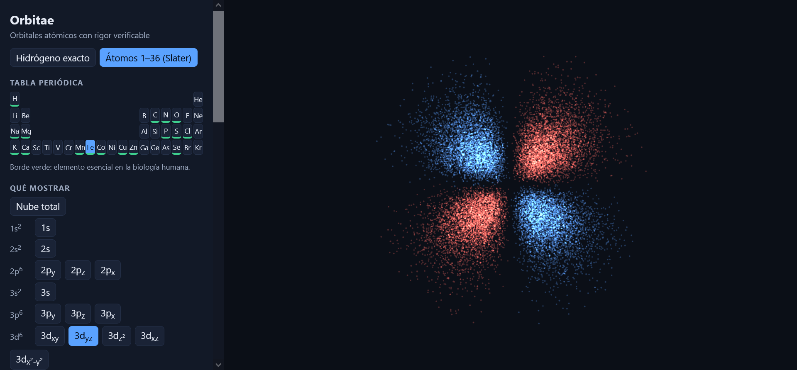

# Orbitae

**Orbitales atómicos con rigor verificable.** Visualiza nubes electrónicas en 3D, del hidrógeno
exacto a los átomos 1-36, con una suite de pruebas numéricas que comprueba cada resultado.

**Demo en línea:** https://amurlaniakea.github.io/orbitae/

> Herramienta educativa y científica. No es un dispositivo médico ni una guía clínica.

## Qué hace

- **Hidrógeno exacto** (modo "Hidrógeno exacto"): orbitales hasta n = 4 (s, p, d, f) con armónicos
  esféricos **reales** (p_x, d_xy, ...), fase en dos colores, energía, radio del 95 % y
  distribución radial con sus nodos.
- **Átomos 1-36** (modo "Átomos"): tabla periódica clicable, nube total y orbitales individuales de
  cada subcapa, con carga efectiva de las reglas de Slater y orbitales tipo Slater.
- **Contexto biomédico**: los elementos esenciales en biología humana van marcados y llevan una
  frase de relevancia (hierro en la hemoglobina, sodio y potasio en el potencial de membrana, etc.).
- **Visor WebGL puro**, sin librerías de terceros y con política CSP que solo permite conectar con
  su propio servidor.

## Límites (a propósito, explícitos)

- Los átomos usan una **aproximación didáctica**: reglas de Slater y orbitales sin nodos radiales,
  sin correlación electrónica. La nube total es el promedio esférico de las subcapas. El error
  frente a Hartree-Fock está medido (ver más abajo).
- Todavía no hay iones ni moléculas. Ver la hoja de ruta.
- Las pruebas automáticas cubren el núcleo en Python. El visor se comprueba a mano en el navegador.

## Instalación y uso

    python3 -m venv .venv && source .venv/bin/activate
    pip install -e ".[dev,hf]"
    pytest -q

Requiere Python 3.10 o superior (probado en 3.10, 3.11 y 3.12) y SciPy 1.15 o superior. PySCF es opcional (`.[hf]`) y solo hace falta para la comparación con
Hartree-Fock.

Para ejecutar el visor en local:

    python -m orbitae.export --out web/data
    python -m orbitae.atoms --out web/data
    python -m orbitae.hf_compare --out web/data   # opcional, requiere PySCF
    python3 -m http.server -d web 8000

Abre http://localhost:8000.

Ejemplo en Python:

    from orbitae import sample_orbital, radial_cutoff

    puntos = sample_orbital(n=2, l=1, m=1, size=50_000, seed=0)   # 2p_x, forma (N, 3)
    r95 = radial_cutoff(2, 1, p=0.95)                              # radio en bohr (a0)

## Validación

Cada resultado numérico tiene una prueba: normalización radial y angular, ortogonalidad, ecuación
de Schrödinger radial, energías E_n = -Z²/(2n²), forma de los armónicos s, p, d y f contra sus
fórmulas cartesianas, nodos radiales contra valores analíticos (2s y 3s), muestreo contra
momentos exactos, cargas efectivas de Slater contra valores de referencia y configuraciones
electrónicas de los 36 elementos. La integración continua las ejecuta en cada cambio.

## Error del modelo de Slater frente a Hartree-Fock

Referencia: Hartree-Fock no restringido con PySCF (base def2-TZVP, espín de Hund, densidad
promediada esféricamente). La métrica es el **radio medio de la densidad electrónica total**
(todos los electrones; no mide el tamaño de valencia). HF no incluye correlación electrónica,
así que tampoco es el valor exacto.

| Elemento | Radio medio HF (a₀) | Radio medio Slater (a₀) | Diferencia |
|---|---|---|---|
| H | 1,499 | 1,500 | +0,1 % |
| C | 1,189 | 1,113 | −6,4 % |
| Ne | 0,788 | 0,715 | −9,4 % |
| Na | 0,987 | 0,990 | +0,4 % |
| Ar | 0,892 | 0,861 | −3,5 % |
| Fe | 0,800 | 1,000 | +25,1 % |
| Cu | 0,726 | 0,828 | +14,1 % |
| Kr | 0,729 | 0,746 | +2,4 % |

El modelo funciona bien en los primeros periodos y falla en los metales de transición 3d
(hasta +26 % en Mn). La tabla de los 36 elementos se genera con
`python -m orbitae.hf_compare` y el visor la muestra sobre la gráfica radial.

## Hoja de ruta

Ver `docs/SDD.md`. Siguiente: comparar también orbitales de valencia y ampliar la referencia;
después iones, moléculas pequeñas y exportación `.cube`.

## Licencia

Copyright (C) Pedro Sordo Martínez. AGPL-3.0-or-later (ver `LICENSE`).
